<picture>
  <source media="(prefers-color-scheme: dark) and (max-width: 600px)" srcset="assets/profile-dark-mobile.svg">
  <source media="(prefers-color-scheme: light) and (max-width: 600px)" srcset="assets/profile-light-mobile.svg">
  <source media="(prefers-color-scheme: dark)" srcset="assets/profile-dark.svg">
  <source media="(prefers-color-scheme: light)" srcset="assets/profile-light.svg">
  
</picture>

# Vishwanath Muthuraman

**Lead Data Engineer · AI systems · Technical delivery**

I build data platforms and AI systems, and lead the work that turns them into dependable products. My experience spans enterprise pipelines, cloud infrastructure, analytics and revenue attribution.

I'm interested in what happens after an AI demo works: changing evidence, unreliable inputs, operational failures and the decisions that need human judgment.

[LinkedIn](https://www.linkedin.com/in/vishwanath-annamalai-muthuraman-8640ab11b/) &nbsp; / &nbsp; [Medium](https://medium.com/@vishwanathmuthuraman19) &nbsp; / &nbsp; [Email](mailto:vishwanathmuthuraman19@gmail.com)

## Public research workspace

Six connected questions about useful, dependable AI. These repositories currently contain **research specifications, synthetic examples and documentation checks**. Application implementation and measured evaluation are planned. The live badges below link to documentation checks; they do not certify algorithm performance.

<table>
<tr>
<td width="50%" valign="top">
<a href="https://github.com/vishwanathmuthuraman/decision-change-lab"><picture>
<source media="(prefers-color-scheme: dark)" srcset="assets/decision-dark.svg">

</picture></a>
<h3><a href="https://github.com/vishwanathmuthuraman/decision-change-lab">Decision Change Lab ↗</a></h3>

Which approved decisions need another review when the facts behind them change?

<code>Evidence dependencies</code> <code>Revalidation</code>

</td>
<td width="50%" valign="top">
<a href="https://github.com/vishwanathmuthuraman/erp-agent"><picture>
<source media="(prefers-color-scheme: dark)" srcset="assets/erp-dark.svg">

</picture></a>
<h3><a href="https://github.com/vishwanathmuthuraman/erp-agent">ERP Agent Testbench ↗</a></h3>

How should an agent behave when an ERP workflow retries, partially fails or changes underneath it?

<code>Failure scenarios</code> <code>Recovery</code>

</td>
</tr>
<tr>
<td width="50%" valign="top">
<a href="https://github.com/vishwanathmuthuraman/finance-exception-investigator"><picture>
<source media="(prefers-color-scheme: dark)" srcset="assets/finance-dark.svg">

</picture></a>
<h3><a href="https://github.com/vishwanathmuthuraman/finance-exception-investigator">Finance Exception Investigator ↗</a></h3>

Trace financial mismatches to their source records and produce explanations a reviewer can check.

<code>Reconciliation</code> <code>Provenance</code>

</td>
<td width="50%" valign="top">
<a href="https://github.com/vishwanathmuthuraman/agency-delivery-orchestrator"><picture>
<source media="(prefers-color-scheme: dark)" srcset="assets/agency-dark.svg">

</picture></a>
<h3><a href="https://github.com/vishwanathmuthuraman/agency-delivery-orchestrator">Agency Delivery Orchestrator ↗</a></h3>

Keep scope, approvals and delivery connected as client requirements and campaign inputs change.

<code>Workflow design</code> <code>Human review</code>

</td>
</tr>
<tr>
<td width="50%" valign="top">
<a href="https://github.com/vishwanathmuthuraman/Transaction-Fraud-Lab"><picture>
<source media="(prefers-color-scheme: dark)" srcset="assets/transaction-dark.svg">

</picture></a>
<h3><a href="https://github.com/vishwanathmuthuraman/Transaction-Fraud-Lab">Transaction Fraud Lab ↗</a></h3>

Study suspicious-payment ranking when feedback arrives late and reviewers have limited capacity.

<code>Temporal evaluation</code> <code>Review budgets</code>

</td>
<td width="50%" valign="top">
<a href="https://github.com/vishwanathmuthuraman/Ledger-Integrity-Lab"><picture>
<source media="(prefers-color-scheme: dark)" srcset="assets/ledger-dark.svg">

</picture></a>
<h3><a href="https://github.com/vishwanathmuthuraman/Ledger-Integrity-Lab">Ledger Integrity Lab ↗</a></h3>

Turn unusual accounting patterns into reviewable evidence, with explicit uncertainty and context.

<code>Accounting integrity</code> <code>Anomaly research</code>

</td>
</tr>
</table>

## Engineering, with the wider picture

| Area | My focus |
| :--- | :--- |
| Data engineering | Python, SQL, Spark, dbt, cloud data platforms, data modeling |
| AI systems | Evaluation design, evidence provenance, workflow reliability, failure analysis |
| Technical delivery | Requirements, project management, stakeholder coordination, risk and tradeoffs |

I hold a **Master's in Management from the University of Illinois Urbana-Champaign**, with a **minor in Risk Management**. That perspective informs how I connect engineering decisions to delivery, cost and operational risk.

## How I approach a problem

**Define the decision → establish a baseline → test the failure cases → measure the tradeoffs.**

My public work is organized around reproducible experiments, documented assumptions and evidence that another engineer can inspect. Financial risk signals are prompts for qualified human review.

---

Interested in reliable AI, data platforms or the practical work of delivering them? [Let's connect.](https://www.linkedin.com/in/vishwanath-annamalai-muthuraman-8640ab11b/)
